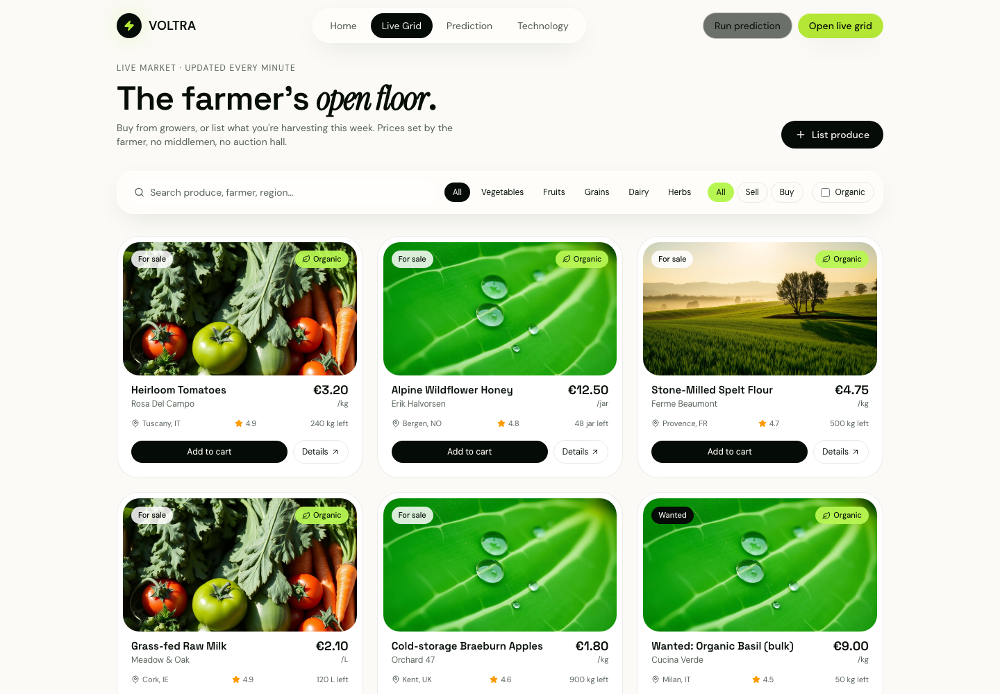
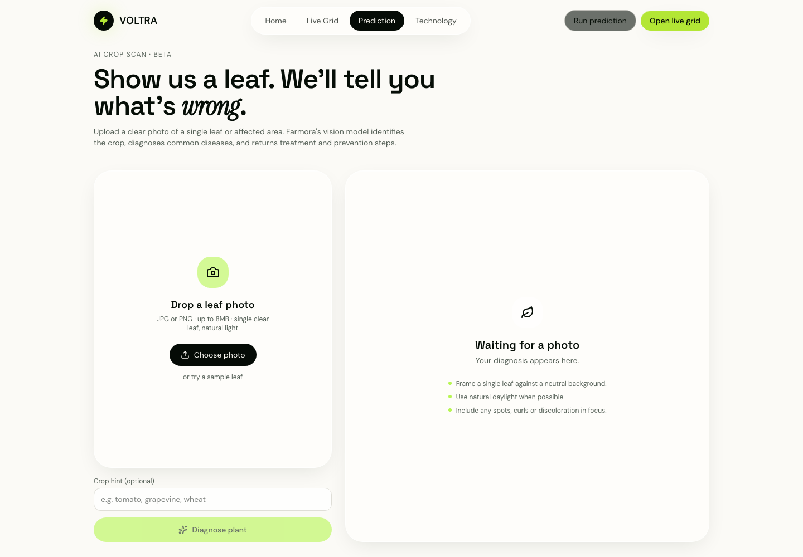

# Farmora — Crop Health & Farm Market

An interface prototype for two farmer workflows: browsing produce listings and checking a crop photo for possible leaf disease. I built this project to explore a calm, practical market experience alongside an AI-assisted crop scan.

## Screens

*Marketplace with seeded listings, category filters and buy/sell controls.*

*Crop photo upload and diagnosis screen.*

## What’s here

- **Produce marketplace** at **/market**: search listings, filter by produce type and transaction, and try a sample listing flow.
- **Crop scan** at **/scan**: upload a leaf image or use the included sample, add an optional crop hint, and request a diagnosis with symptoms, severity, treatment and prevention.
- **About page** at **/about**: product concept and workflow notes.
- Responsive layouts, reusable interface components and sample market data.

The crop scan calls a server-side vision service. Configure the private model gateway key expected by the source file **src/lib/ai-gateway.server.ts** before using the scan; never commit that key.

## Tech

- React and TypeScript
- TanStack Start and TanStack Router
- Vite, Tailwind CSS and shadcn-style components
- Recharts and Lucide icons
- Server functions for image analysis

## Run locally

~~~sh
bun install
bun run dev
~~~

Open the local URL printed by Vite. To use crop diagnosis, configure the server-side model gateway key in your local environment first.

## Prototype notes

Listings are seeded demo data and the market interactions are not connected to a real buying or selling service. AI crop results are model-generated suggestions, not verified agronomic advice. The repository currently contains two prototype surfaces: the root route is a predictive electricity-grid concept called VOLTRA; the farmer marketplace and crop scan are the Farmora routes at **/market** and **/scan**.

## Author

Built by [Om Rashiya](https://github.com/rashiyaom).
